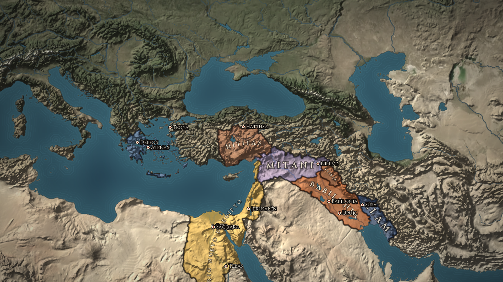

<div align="center">

# TellMAP

**World history on a living map, with its sources at hand.**<br>
[Español](README.md) · [Site](https://bafif.github.io/tmap/) · [Install](#install) · [How to use it](#how-to-use-it)

</div>

Slide the timeline and watch borders shift, cities rise and the texts written in each place appear. A *tell* is the
mound left by centuries of cities built one on top of another: in TellMAP you pick a place, dig through its layers,
and in each one find who ruled it, who lived there, what happened and what was written. In English and Spanish, for
Linux, Windows and macOS.

<p align="center"></p>

## Why TellMAP

- **Borders with a backbone.** They come from
  [Cliopatria](https://github.com/Seshat-Global-History-Databank/cliopatria), from the Seshat Global History Databank:
  13,400 records reviewed by historians, from 3400 BC to 2024. The map is split into 58,000 units that follow those
  borders, not a grid that approximates them.
- **Every text in two places.** A source sits where and when it was written, and in the place and period it is
  about. In Egypt in 1350 BC you find the *Great Hymn to the Aten*, written at Amarna at that very moment, Herodotus,
  who told the story nine centuries later, and the Egyptologists who studied it in the 20th century.
- **Sources first.** Every entry tells primary sources from studies, says how certain its date is and links to the
  full text on Wikisource, Perseus, Project Gutenberg or the Internet Archive when it's in the public domain.
- **Nothing made up.** Population figures are published estimates, with their author and range; the ones given by
  ancient authors are shown apart, as testimony. What isn't known is said to be unknown.
- **An encyclopedia that grows in the open.** It's readable JSON packages, edited with forms inside the app. New
  entries start from Wikipedia and Wikidata drafts, and the ones an AI writes cite their sources and aren't published
  without human review.
- **No accounts, no telemetry.** It runs on your computer. It only goes online to ask Wikipedia and Pleiades for the
  summary of the entry you open (it's cached) and to check GitHub for updates, which can be turned off in Settings.

## Install

Download the zip for your system from the [latest release](https://github.com/bafif/tmap/releases/latest), unzip it
and open the app: there's nothing to install.

| System | File |
|---|---|
| Linux | `TellMAP-<version>-linux-x86_64.zip` |
| Windows | `TellMAP-<version>-windows-x86_64.zip` |
| macOS (Intel and Apple Silicon) | `TellMAP-<version>-macos-universal.zip` |

The macOS build isn't notarized by Apple: the first time, open it from **System Settings → Privacy & Security**
([how](docs/en/install.md#macos-the-first-time)). After that, when it opens, the app tells you if there's a new
version and downloads nothing until you say yes.

To run it from the source you need [Godot 4.7](https://godotengine.org/download):

```bash
git clone https://github.com/bafif/tmap.git
godot --path tmap
```

## How to use it

1. **Move the timeline** at the bottom: a click picks the year, dragging scrolls through it and the space bar lets
   time run.
2. **Click a place.** Its entry opens on the right, with the tabs "Summary", "History", "Sources", "People and events"
   and "Data".
3. **Open "Sources"**: what was written there and then, and what was written later about that place and time, with
   the link to read it.
4. **Change the mode** with the buttons at the top or the keys 1 to 5: political, terrain, religion, culture and
   language.

F1 opens the help with every shortcut. On a touchscreen, one finger moves the map and two zoom in or out.

## Status

- **Released version:** 0.3.5. Touch support and the Pleiades places are already in the code and ship with the next one.
- **Linux:** tested with Vulkan and with OpenGL; the automatic test runs on every change.
- **macOS:** tested on an Intel Mac. On Apple Silicon, continuous integration opens it and checks that it draws, but
  it hasn't been tried on a real one yet.
- **Windows:** the executable passes the full test under wine, but it hasn't been tried on a real Windows machine yet.
- **Touchscreens:** the automatic test covers the gestures; they still need trying on a real screen.
- **The encyclopedia:** ancient Egypt, medieval Europe, the Holy Land, Argentina, the Indigenous peoples of the
  Americas and their colonization, the contemporary era and the Celts, plus regions with their estimated population
  over almost all the land. What's covered and what's missing is in
  [the coverage report](docs/en/coverage.md).
- **What's next:** people from Wikidata and population grids, animated migrations and routes, a 3D view and a browser
  version. The details are in [the progress page](PROGRESO.en.md).

## More documentation

- [Install](docs/en/install.md): each system, the first time on macOS, the rendering engine and running it from the
  source.
- [Updates](docs/en/updates.md): what updates itself, how it's published and how it's tested.
- [The encyclopedia](docs/en/encyclopedia.md): what's in it, how it gets filled in, the editor and the editorial rules.
- [Entry schema](data/enciclopedia/ESQUEMA.en.md): the format of sources, people, events, places and regions.
- [Coverage](docs/en/coverage.md): which regions, periods and data are covered, generated from the data.
- [Data and licenses](docs/en/data.md): where each piece of data comes from, how it's processed and its license.
- [Plan](docs/en/plan.md): how the map is built, the technical decisions and the roadmap.
- [Storage and downloads](docs/en/storage.md): how much each thing weighs and how the app will fetch the bulk data.
- [Progress](PROGRESO.en.md): what's left and the milestones of each version.
- [How to work on TellMAP](docs/en/contributing.md): conventions, tests and [the bridge](tools/godot/README.en.md) to
  drive the app from the terminal.
- [Data pipeline](tools/pipeline/README.en.md): how the map and the borders are generated.

## Author

Made by **Bautista D. Fiori** ([LinkedIn](https://www.linkedin.com/in/b-d-fiori/) · [GitHub](https://github.com/bafif)).
If you want to use it for teaching, add sources from your field or help with the code, get in touch.

## License

The code is [AGPL-3.0-or-later](LICENSE): you may use, modify and share it; if you offer a modified version over a
network, you must offer its source code too. The project's own encyclopedia is CC BY-SA 4.0, and the rest of the data
keeps its own licenses ([Data and licenses](docs/en/data.md)): Cliopatria (CC BY 4.0), Natural Earth and NASA (public
domain), Wikipedia (CC BY-SA 4.0), Our World in Data (CC BY 4.0), Pleiades (CC BY 3.0) and the Cinzel and EB Garamond
typefaces (SIL Open Font License).
