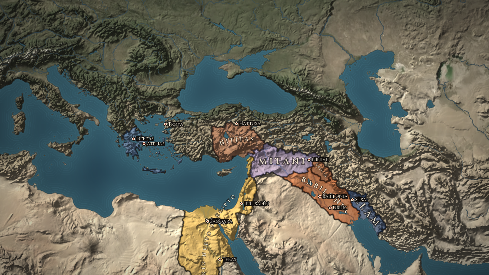
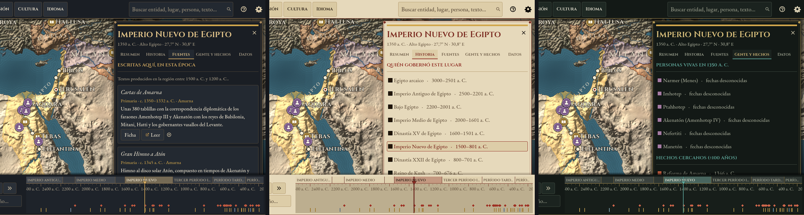
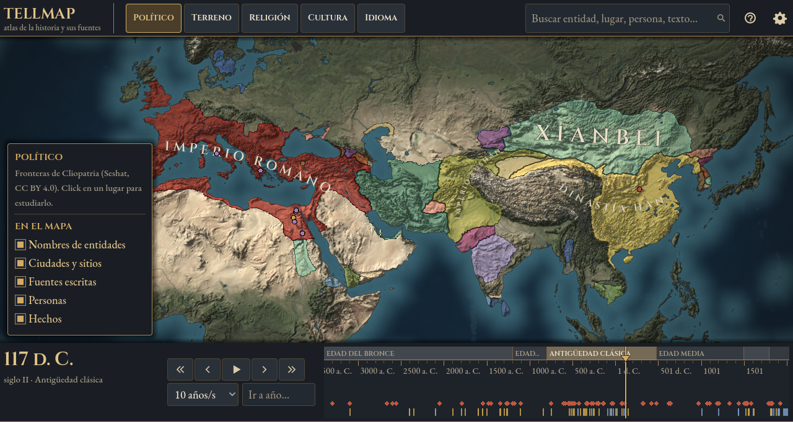

<p align="center">
  
</p>

<p align="center">
  <strong>La historia del mundo en un mapa vivo, con sus fuentes a mano.</strong><br>
  Mové la línea de tiempo y mirá cómo se corren las fronteras, nacen las ciudades y aparecen los textos que se
  escribieron en cada lugar.
</p>

<p align="center">
  <a href="LICENSE"></a>
  
  <a href="https://github.com/bafif/tmap/actions/workflows/pruebas.yml"></a>
  <a href="https://bafif.github.io/tmap/"></a>
  
  
  <a href="README.en.md"></a>
</p>

---

## Por qué existe

La historia se suele estudiar en capítulos: un libro para Egipto, otro para Roma y un atlas aparte. Las fuentes, que son
lo que de verdad sabemos, quedan al final, en una bibliografía que casi nadie abre. Así cuesta ver que todo pasó al
mismo tiempo en un mismo mundo, y que cada afirmación se apoya en un texto que alguien escribió en un lugar y en un
momento.

Hago TellMAP para estudiar historia al revés: empezando por el mapa y por las fuentes. Un *tell* es la colina que dejan
siglos de ciudades levantadas una sobre otra, y cada capa es una época. TellMAP hace lo mismo con el mundo: elegís un
lugar, bajás por sus capas y en cada una encontrás quién gobernaba, quién vivía ahí, qué pasó y qué se escribió.

## Una biblioteca ordenada en el espacio y el tiempo

Cada texto tiene **dos coordenadas**: dónde y cuándo se escribió, y de qué lugar y época trata. Por eso, si vas a Egipto
en 1350 a. C., encontrás tanto el *Gran Himno a Atón*, escrito en Amarna en ese momento, como a Heródoto, que lo contó
novecientos años después, y a los egiptólogos del siglo XX que lo estudiaron desde Londres o Chicago.

| Qué hacés | Qué ves |
|---|---|
| **Deslizás la línea de tiempo** | Las fronteras de 1637 entidades políticas, de 3400 a. C. a 2024, que se mueven año por año |
| **Hacés click en un lugar** | Un panel que se abre desde la derecha con quién gobernó ese punto en cada siglo, sus eras, su población estimada, su religión y su idioma |
| **Abrís la pestaña Fuentes** | Lo escrito *ahí y entonces* (fuentes primarias) y lo escrito *sobre* ese lugar y esa época (estudios), con el enlace para leerlos |
| **Dejás correr el tiempo** | Pensadores que aparecen mientras viven, hechos que destellan en su fecha y ciudades que se fundan y desaparecen |

<p align="center">
  
</p>

Con tres temas para la interfaz (Mármol y bronce, Pergamino iluminado, y Tinta y latón) y cuatro niveles de calidad
gráfica, para que ande bien desde una notebook vieja hasta una computadora de juegos.

<p align="center">
  
</p>

## Lo que lo hace distinto

- **Fronteras con respaldo.** Usa [Cliopatria](https://github.com/Seshat-Global-History-Databank/cliopatria), la base
  de datos geográfica del Seshat Global History Databank: 13 400 registros revisados por historiadores. El mapa se
  divide en 58 000 unidades que siguen esas fronteras reales, no una grilla que las aproxima.
- **Fuentes primero.** Cada ficha distingue fuentes primarias de secundarias, dice qué tan segura es su fecha y lleva a
  textos completos en Wikisource, Perseus, el Proyecto Gutenberg o Internet Archive cuando están en dominio público.
- **Nada inventado.** Las cifras antiguas son estimaciones publicadas, con su autor y su rango de incertidumbre. Lo que
  no se sabe, se dice.
- **La estética de los grandes mapas de estrategia.** Relieve sombreado, ríos, costas con líneas de carta náutica,
  nombres que se curvan sobre el territorio y tres temas para la interfaz: Mármol y bronce, Pergamino iluminado, y
  Tinta y latón.
- **Hecho para crecer de a poco.** La enciclopedia son archivos JSON legibles, por paquetes, que se editan con
  formularios dentro de la app. Hoy trae un piloto completo sobre el antiguo Egipto, la Europa medieval con su filosofía,
  Tierra Santa de la Antigüedad a hoy y regiones que cubren el resto del mundo con su población estimada; el
  resto se completa por etapas, y [un informe que se genera solo](docs/es/cobertura.md) dice qué está cubierto y qué
  no, empezando por lo más consultado, con borradores de Wikipedia y Wikidata e IA que
  siempre cita sus fuentes y pasa por revisión humana.
- **Sin cuentas ni telemetría.** Corre en tu computadora. Lo único que sale a internet es la consulta a Wikipedia
  cuando abrís una ficha, que queda en caché, y la búsqueda de [actualizaciones](docs/es/actualizaciones.md) en GitHub
  al abrir la app, que no manda nada tuyo y se apaga en Ajustes.
- **Se actualiza sola.** Al abrir, la versión descargada te avisa si hay algo nuevo y lo instala si le decís que sí
  («Ahora no» la deja como está). Cuando solo hay datos nuevos (más fuentes, personas, hechos o regiones) baja nada
  más los archivos que cambiaron, sin reinstalar el programa.

## Probarlo

Lo más simple es bajar la [última versión](https://github.com/bafif/tmap/releases/latest) para Linux, Windows o macOS:
se descomprime y se abre, sin instalar nada. La versión de macOS no está notarizada por Apple: la primera vez, macOS
dice que no puede comprobarla; se abre igual desde **Configuración del Sistema → Privacidad y seguridad**, o en la
Terminal con `xattr -dr com.apple.quarantine TellMAP.app`.

Para correrla desde el código hace falta [Godot 4.7](https://godotengine.org/download) (es libre y pesa unos 100 MB).

```bash
git clone https://github.com/bafif/tmap.git
godot --path tmap            # o abrí la carpeta desde el editor de Godot
```

Para revisar que todo ande, `godot --headless --path tmap -- --prueba` recorre la app sola y avisa si algo falla;
`tools/captura.sh` saca capturas sin monitor y [el puente](tools/godot/README.md) deja manejar la app y el
editor desde la terminal o con un agente de IA. Los datos del mapa ya vienen generados en `data/mapa/`. Para regenerarlos desde las fuentes originales, o con otra
versión de Cliopatria, seguí [el pipeline de datos](tools/pipeline/README.md).

## Estado

Versión 0.1: la primera que funciona de punta a punta. El detalle de lo hecho y lo que falta está en
[PROGRESO.md](PROGRESO.md).

- [x] Mapa 2D del mundo con relieve, ríos, costas y proyección de Miller
- [x] Fronteras políticas de 3400 a. C. a 2024, con nombres que siguen la forma del territorio
- [x] Línea de tiempo con reproducción, eras globales y locales, hechos y fuentes
- [x] Panel lateral: resumen, historia del lugar, fuentes, gente y hechos, datos
- [x] Resúmenes de Wikipedia en vivo, en español primero
- [x] Enciclopedia piloto del antiguo Egipto y muestra de once regiones
- [x] Paquete de la Europa medieval: 15 regiones, 173 fuentes (con énfasis en la filosofía), 215 personas, 125 hechos
      y 120 lugares, verificados contra Wikipedia y Wikidata
- [x] Regiones para todo el mundo (88, sobre el 99,6 % de la tierra firme), con población estimada desde el 10 000 a. C.
      (HYDE, Gapminder y la ONU, vía Our World in Data) y un informe de cobertura que se genera solo
- [x] Paquete de Tierra Santa: 7 regiones, 176 fuentes (escrituras, crónicas de las cruzadas de todos los lados,
      pensamiento judío, cristiano y musulmán, documentos modernos), 198 personas, 172 hechos y 75 lugares, verificados
      de la misma manera
- [x] Modos de religión, cultura e idioma (solo donde hay datos), con el contorno real de cada época
- [x] Fichas de cada religión, cultura, idioma y entidad política; leyenda, línea de tiempo y gráficos tocables
- [x] Marcadores agrupados, atajos de teclado y cuatro temas visuales (uno de alto contraste)
- [x] Cuatro niveles de calidad gráfica y una prueba automática que hace clic en cada control
- [ ] Vista 3D con relieve, agua y efectos
- [ ] Llenado progresivo de la enciclopedia con IA y revisión humana
- [ ] Migraciones, rutas y movimientos de pueblos animados
- [x] Versiones descargables para Linux, Windows y macOS, que se exportan solas al publicar una versión en GitHub
- [ ] Versión para el navegador

## Documentación

| | |
|---|---|
| [Plan del proyecto](docs/es/plan.md) | Arquitectura, decisiones técnicas y hoja de ruta por fases |
| [Datos y licencias](docs/es/datos.md) | De dónde sale cada dato, cómo se procesa y bajo qué licencia |
| [La enciclopedia](docs/es/enciclopedia.md) | Cómo se completa, Wikipedia y Grokipedia, IA y reglas editoriales |
| [Cobertura](docs/es/cobertura.md) | Qué regiones, épocas y datos están cubiertos y qué falta, generado a partir de los datos |
| [Esquema de fichas](data/enciclopedia/ESQUEMA.md) | El formato de las fuentes, personas, hechos, lugares y regiones |
| [Pipeline de datos](tools/pipeline/README.md) | Cómo se generan el mapa y las fronteras |
| [Cómo trabajar en TellMAP](docs/es/contribuir.md) | Convenciones, pruebas y el puente para manejar la app y el editor |

## Autor

Lo hago yo, **Bautista D. Fiori**. Si querés usarlo para enseñar, sumar fuentes de tu especialidad o ayudar con el
código, escribime.

[LinkedIn](https://www.linkedin.com/in/b-d-fiori/) · [GitHub](https://github.com/bafif)

## Licencia

El código es [AGPL-3.0-or-later](LICENSE): podés usarlo, modificarlo y compartirlo; si ofrecés una versión modificada
por red, tenés que ofrecer también su código. Los datos conservan sus licencias, que están detalladas en
[Datos y licencias](docs/es/datos.md): Cliopatria (CC BY 4.0), Natural Earth y NASA (dominio público), Wikipedia
(CC BY-SA 4.0), la población de Our World in Data (CC BY 4.0), y las tipografías Cinzel y EB Garamond (SIL Open Font License).
